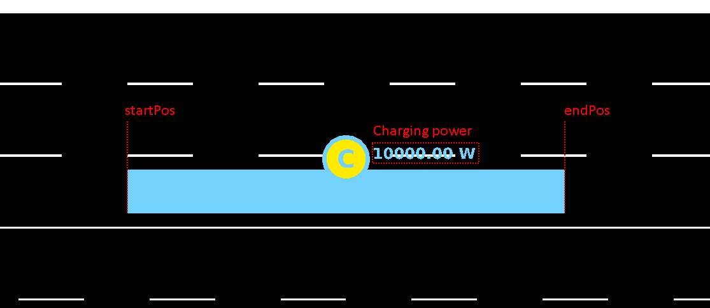
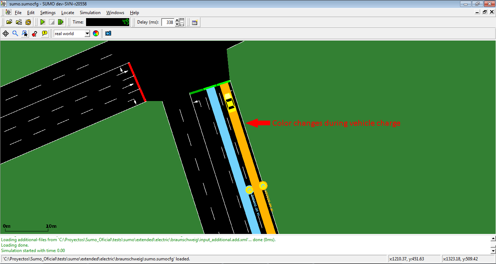

# Overview

Since version 0.24.0 SUMO includes a model for electric vehicles. It was
implemented by Tamás Kurczveil and Pablo Álvarez López from the
[TU-Braunschweig](https://www.tu-braunschweig.de/). The core of the
model is implemented in the [vehicle
device](../Developer/How_To/Device.md) *device.battery*. Additional
features are a charging station (which can be placed on any lane in the
network) and a new output option **--battery-output** {{DT_FILE}}.

You can find a test case for these implementations at
[\[1\]](https://github.com/eclipse-sumo/sumo/tree/main/tests/sumo/devices/battery/braunschweig)

# Defining Electric Vehicles

Different aspects of electric vehicles are modeled separately. This page puts the focus
on modeling the battery and how it is charged and discharged. The actual energy consumption values themselves
are part of the emission modeling because SUMO can use different models for that.

To track the charging status of a vehicle, it must be equipped with a battery
device. This may be done using the option **--device.battery.explicit <vehID1,vehID2,...\>** or simply setting **--device.battery.probability 1** to equip
all vehicles. Alternatively, the device may be specified using [Generic
vehicle parameters](../Definition_of_Vehicles,_Vehicle_Types,_and_Routes.md#devices).

Additional properties of the vehicle and its electrical components must
then be defined via [parameters of the vehicle or its
type](../Simulation/GenericParameters.md).
Note, that some parameters are specific to the battery device and thus carry the `device.battery` prefix. These can be defined either in the `<vType>` or the `<vehicle`.
Other parameters are more general and also used by other models (i.e. emission models) and thus carry no prefix. All of the later must be defined in the `<vType>`.

These values have the following meanings (the defaults are from the Kia below):

| key                               | Value Type | Default           | Description                                             |
| --------------------------------- | ---------- | ----------------- | ------------------------------------------------------- |
| device.battery.capacity           | float      | 35000 (Wh)        | Maximum battery capacity *E<sub>max</sub>*              |
| device.battery.maximumChargeRate  | float      | 150000 (W)        | Maximum charging rate of the battery                    |
| device.battery.chargeLevelTable   | float list |                   | Ordered list of state of charge values (from 0 to 1) for which maximum charge rates are defined in `device.battery.chargeCurveTable` |
| device.battery.chargeCurveTable   | float list |                   | Corresponding maximum charge rates to each state of charge value in `device.battery.chargeLevelTable` |
| device.battery.maximumDischargeRate | float    | 0 (W)             | Maximum rate at which the battery is discharged into a [charging station that accepts discharging](#vehicle-to-grid). The default 0 disables discharging |
| device.battery.minimumChargeLevel | float      | 0 (Wh)            | Charge level which is kept when [discharging into a charging station](#vehicle-to-grid) |
| maximumPower                      | float      | 150000 (W)        | Maximum power which the vehicle can reach (unused)      |
| vehicleMass                       | float      | 1830 (kg)         | Vehicle mass *m<sub>veh</sub>* (deprecated)             |
| loading                           | float      | 0 (kg)            | Additional mass **(to be defined in the vehicle type)** |
| frontSurfaceArea                  | float      | 2.6 (m<sup>2</sup>) | Front surface area *A<sub>veh</sub>*                  |
| airDragCoefficient                | float      | 0.35              | Air drag coefficient *c<sub>w</sub>*                    |
| rotatingMass                      | float      | 40 (kg)           | (Equivalent) mass of internal rotating elements         |
| radialDragCoefficient             | float      | 0.1               | Radial drag coefficient c<sub>rad</sub>                 |
| rollDragCoefficient               | float      | 0.01              | Rolling resistance coefficient *c<sub>roll</sub>*       |
| constantPowerIntake               | float      | 100 (W)           | Avg. (constant) power of consumers *P<sub>const</sub>*  |
| propulsionEfficiency              | float      | 0.98              | Drive efficiency *η<sub>prop</sub>*                     |
| recuperationEfficiency            | float      | 0.96              | Recuperation efficiency *η<sub>recup</sub>*             |
| stoppingThreshold                 | float      | 0.1 (m/s)         | Maximum velocity to start charging                      |

!!! note
    Before SUMO 1.20.0 the `rotatingMass` was called `internalMomentOfInertia` but it has been renamed to make clear
    that it is a mass and not a moment of inertia. The old parameter is considered deprecated.
    Also the `vehicleMass` has been deprecated in favor of the new `mass` attribute of vehicles / vehicle types.

An example of a vehicle with electric attribute (those are the values for a city bus from the original publication):

```xml
<routes>
    <vType id="ElectricBus" accel="1.0" decel="1.0" length="12" maxSpeed="100.0" sigma="0.0" minGap="2.5" mass="10000" color="1,1,1">
        <param key="has.battery.device" value="true"/>
        <param key="device.battery.capacity" value="2000"/>
        <param key="maximumPower" value="1000"/>
        <param key="frontSurfaceArea" value="5"/>
        <param key="airDragCoefficient" value="0.6"/>
        <param key="rotatingMass" value="100"/>
        <param key="radialDragCoefficient" value="0.5"/>
        <param key="rollDragCoefficient" value="0.01"/>
        <param key="constantPowerIntake" value="100"/>
        <param key="propulsionEfficiency" value="0.9"/>
        <param key="recuperationEfficiency" value="0.9"/>
        <param key="stoppingThreshold" value="0.1"/>
        <param key="device.battery.maximumChargeRate" value="150000"/>
    </vType>
</routes>
```

If a vehicle has a battery device (and is not [tracking fuel](#tracking_fuel_consumption_for_non-electrical_vehicles))
and no explicit `emissionClass` is defined, it will be assigned the emission class `Energy/unknown`.
It will not use the [default emission class](../Vehicle_Type_Parameter_Defaults.md) derived from the vehicle class then.
This is for backward compatibility and will issue a warning because in general it is preferable to set the emission class explicitly.
Most of the parameters above do actually apply to this emission class and not to the battery device itself.

The initial energy content of the battery (by default `0.5*device.battery.capacity`) can
be set in the vehicle definitions

```xml
<routes>
    <vehicle id="0" type="type1" depart="0" color="1,0,0">
        <param key="device.battery.chargeLevel" value="500"/>
    </vehicle>
</routes>
```

The charging rate of the battery at a charging station is limited to model the effects of battery management controllers (e.g. charge a nearly full battery less than an nearly empty one).
There are two ways to define the maximum charge rate: For a constant rate set the attribute `device.battery.maximumChargeRate`.
If instead a maximum charge rate depending on the state of charge is wanted, it can be defined through data points between which the rate will get interpolated.
The states of charge have to be given in `device.battery.chargeLevelTable` and the corresponding charge rates in `device.battery.chargeCurveTable`.
If defined, the maximum charge curve takes precedence over the constant maximum charge rate `device.battery.maximumChargeRate`. An example definition where the charge rate decreases above
50% state of charge looks like the following:

```xml
<routes>
    <vehicle id="0" type="type1" depart="0" color="1,0,0">
        <param key="device.battery.chargeLevelTable" value="0 0.5 1"/>
        <param key="device.battery.chargeCurveTable" value="45000 45000 20000"/>
    </vehicle>
</routes>
```

# Vehicle behavior

By default, vehicle behavior will not be affected by battery level. Car will keep driving even when their battery capacity is at 0. To avoid this, either [TraCI](#traci) must be used to change speed or route based on the current battery level or
the [stationfinder device](../Simulation/Stationfinder.md) can be configured to monitor the battery capacity.

# Charging Stations

A charging station is a surface defined on a lane in which the vehicles
equipped with a battery are charged. The basic structure and parameters
of bus stops were used for the implementation of charging stations.
A charging station can be converted to a gas station by setting the **chargeType** attribute to `fuel`. Then electric vehicles cannot charge there anymore.


| key                 | Value Type | Value range                                                                                | Default   | Description         |
| ------------------- | ---------- | -------------------------------- | --------- | ----------------------------------------------------------------------------- |
| **id**              | string     | id                                                                                         |           | Charging station ID (Must be unique)                                                                                            |
| name                | string     | simple String                                                                              |           | Charging station name. This is only used for visualization purposes.                                                            |
| **lane**            | string     | valid lane id                                                                              |           | Lane of the charging station location                                                                                           |
| **startPos**        | float      | lane.length < x < lane.length (negative values count backwards from the end of the lane) | 0         | Begin position in the specified lane                                                                                            |
| **endPos**          | float      | lane.length < x < lane.length (negative values count backwards from the end of the lane) |           | End position in the specified lane                                                                                              |
| friendlyPos | bool | true or false | false | Whether invalid charging station positions should be corrected automatically |
| **power**           | float  (W) or (mg/s)  | power \> 0  | 22000  | Charging power *P<sub>chrg</sub>*  (If the battery device being charged  [is configured to track fuel](#tracking_fuel_consumption_for_non-electrical_vehicles), charging power will be interpreted as mg/s)  |
| totalPower          | float  (W) or (mg/s)  | power >= 0  | 0  | Max. charging power *P<sub>chrg</sub>* sum for all charging vehicles of this station (to be shared at the ratio of requested power). Is only active for values > 0. |
| dischargePower      | float  (W)  | dischargePower >= 0  | 0  | Max. power *P<sub>dis</sub>* fed back into the grid per discharging vehicle ([vehicle-to-grid](#vehicle-to-grid)). Is only active for values > 0. |
| **efficiency**      | float      | 0 <= efficiency <= 1                                                                       | 0.95   | Charging efficiency *η<sub>chrg</sub>* (also applies to discharging)                                                           |
| **chargeInTransit** | bool       | true or false                                                                              | false  | Enable or disable charge in transit, i.e. vehicle is forced/not forced to stop for charging                                     |
| **chargeDelay**     | float      | chargeDelay >= 0                                                                           | 0         | Time delay after the vehicles have reached / stopped on the charging station, before the energy transfer (charging) is starting |
| chargeRampUp        | float (W/s) | chargeRampUp >= 0                                                                         | 0         | Power ramp-up rate when session power magnitude increases (0 = instantaneous)                                                   |
| chargeRampDown      | float (W/s) | chargeRampDown >= 0                                                                       | 0         | Power ramp-down rate when session power magnitude decreases (0 = instantaneous)                                                 |
| chargeStopDelay     | time (s)   | chargeStopDelay >= 0                                                                       | 0         | Time before the planned end of a stop (`duration` / `until`) at which target station power drops to 0 so power ramps down / decouples before departure |
| chargeType | string | {normal, battery-exchange, fuel} | normal | Charging type  |
| parkingArea         | string     | valid parkingArea id                                                                       |        | id of the parking the charging station should be positioned on (optional) - vehicles will only charge after reaching the parking

Charging stations are defined in additional using the following format:

```xml
<additional>
    <chargingStation chargeDelay="2" chargeInTransit="0" power="200000" efficiency="0.95" endPos="25" id="cS_2to19_0a" lane="2to19_0" startPos="10"/>
</additional>
```

And are represented in the simulation as shown:


Representation of chargingStation in GUI


Color of chargingStation during charge

!!! note
    If the charging station shall be positioned on a parking (using the attribute **parkingArea**), the referenced parkingArea has to defined beforehand/loaded before the charging station.


## Stopping at a Charging Station

A stop at a charging station may occur due to traffic conditions,
stopping at a defined location or stopping at an explicit
chargingStation as defined below:

```xml
<routes>
    <vehicle id="v0" route="route0" depart="0">
        <stop chargingStation="myChargingStationID" until="50"/>
    </vehicle>
</routes>
```

## Vehicle-to-grid

A charging station with `dischargePower` > 0 also accepts energy from the vehicles stopping there (bidirectional charging, vehicle-to-grid).
A vehicle takes part if its battery parameter `device.battery.maximumDischargeRate` is positive.
While such a vehicle is [stopping](#stopping_at_a_charging_station) at such a station (a vehicle which is only slowed down, e.g. in a jam, does not count) and the `chargeDelay` has passed, its battery is kept at the level `device.battery.minimumChargeLevel`:

- above this level, the battery is discharged into the station until the level is reached
- below this level, the battery is charged with the normal charging power of the station until the level is reached
- at this level, no energy is exchanged

Like `power`, the `dischargePower` of the station applies to the grid side.
The energy taken from the battery in a simulation step of length *Δt* is therefore

*E<sub>dis</sub>* = min(*P<sub>dis</sub>* / *η<sub>chrg</sub>*, `maximumDischargeRate`) · *Δt*, but at most `chargeLevel` - `minimumChargeLevel`

and the grid receives *E<sub>dis</sub>* · *η<sub>chrg</sub>*.
Vehicles which are not stopping (e.g. moving across a station with `chargeInTransit="true"`) are charged as usual and are never discharged.
Vehicles [tracking fuel](#tracking_fuel_consumption_for_non-electrical_vehicles) and stations with a `chargeType` other than `normal` never discharge.
Discharging vehicles do not count towards the `totalPower` of a station.
The energy used for driving (`totalEnergyConsumed`) does not include the discharged energy.

```xml
<additional>
    <chargingStation id="cs0" lane="E0_0" startPos="10" endPos="30" power="11000" dischargePower="11000" efficiency="0.9"/>
</additional>
<routes>
    <vehicle id="v0" route="route0" depart="0">
        <param key="device.battery.chargeLevel" value="40000"/>
        <param key="device.battery.maximumDischargeRate" value="11000"/>
        <param key="device.battery.minimumChargeLevel" value="20000"/>
        <stop chargingStation="cs0" duration="3600"/>
    </vehicle>
</routes>
```

All these values can be changed at runtime with [TraCI](#controlling_vehicle-to-grid). The discharged energy is reported as `energyDischarged` in the [battery-output](#battery-output),
in the [charging station output](#charging_station_output) and as `totalEnergyDischarged` in the battery element of the [tripinfo-output](../Simulation/Output/TripInfo.md#battery).
These attributes are only written for stations and vehicles taking part in vehicle-to-grid.

## Session power ramps and stop delay

By default (`chargeRampUp="0"`, `chargeRampDown="0"`, `chargeStopDelay="0"`), charging and [vehicle-to-grid](#vehicle-to-grid) discharging apply rectangular power steps.
When `chargeRampUp`, `chargeRampDown` or `chargeStopDelay` are positive, each vehicle's signed grid-side session power (*+W* when charging, *-W* when discharging) follows a piecewise-linear trapezoidal trajectory over each simulation step:

- `chargeRampUp` (in W/s) limits how fast session power magnitude increases toward the target charging or discharging power.
- `chargeRampDown` (in W/s) limits how fast session power magnitude decreases toward a lower target or 0 (crossing 0 cleanly when switching between charging and discharging).
- `chargeStopDelay` (in s) sets the target power to 0 during the final `chargeStopDelay` seconds of a planned stop (`duration` / `until`), allowing power to ramp down and hold at 0 before departure.

These parameters can also be queried and updated dynamically via `traci.chargingstation.getParameter` and `traci.chargingstation.setParameter` using keys `"chargeRampUp"`, `"chargeRampDown"` and `"chargeStopDelay"`, while `"actualPower"` (read-only) returns the sum of current signed station power in W across vehicles served at the station (`"0.00"` when idle).

## Charging Station output

There are two variants of the charging station output. One lists values for all time steps whereas the other
aggregates the data into charging events (thus related to the whole time a vehicle was connected to the charging station).

### Full report

Option **--chargingstations-output chargingstations.xml** generates a full
report of energy charged by charging stations:

```xml
<output>
    <battery-output value="battery.xml"/>
    <chargingstations-output value="chargingstations.xml"/>
</output>
```

File chargingstations.xml has the following structure:

```xml
<chargingstations-export>
    <chargingStation id="CS1" totalEnergyCharged="71.25" chargingSteps="27">
        <vehicle id="veh0" type="ElectricVehicle1" totalEnergyChargedIntoVehicle="15.83" chargingBegin="12.00" chargingEnd="17.00">
            <step time="12.00" chargingStatus="chargingStopped" energyCharged="2.64" partialCharge="2.64" power="10000.00" efficiency="0.95" actualBatteryCapacity="12962.97" maximumBatteryCapacity="35000.00"/>
            <step time="13.00" chargingStatus="chargingStopped" energyCharged="2.64" partialCharge="5.28" power="10000.00" efficiency="0.95" actualBatteryCapacity="12965.59" maximumBatteryCapacity="35000.00"/>
            <step time="14.00" chargingStatus="chargingStopped" energyCharged="2.64" partialCharge="7.92" power="10000.00" efficiency="0.95" actualBatteryCapacity="12968.22" maximumBatteryCapacity="35000.00"/>
        </vehicle>
        <vehicle id="veh1" type="ElectricVehicle2" totalEnergyChargedIntoVehicle="5.28" chargingBegin="17.00" chargingEnd="18.00">
            <step time="17.00" chargingStatus="chargingStopped" energyCharged="2.64" partialCharge="18.47" power="10000.00" efficiency="0.95" actualBatteryCapacity="11967.35" maximumBatteryCapacity="35000.00"/>
            <step time="18.00" chargingStatus="chargingStopped" energyCharged="2.64" partialCharge="21.11" power="10000.00" efficiency="0.95" actualBatteryCapacity="12978.72" maximumBatteryCapacity="35000.00"/>
        </vehicle>
        ...
    </chargingStation>
        ...

    ...
</chargingstations-export>
```

For the entire ChargingStation:

| Name               | Type   | Description                                                 |
| ------------------ | ------ | ----------------------------------------------------------- |
| id                 | string | ChargingStation ID                                          |
| totalEnergyCharged | float  | Total energy charged in Wh during the entire simulation      |
| totalEnergyDischarged | float  | Total energy in Wh taken from vehicle batteries by [discharging](#vehicle-to-grid) during the entire simulation (only for stations with `dischargePower` > 0) |
| chargingSteps      | int    | Number of steps in which chargingStation was charging energy |

For the current charging vehicle

| Name                          | Type   | Description                                                   |
| ----------------------------- | ------ | ------------------------------------------------------------- |
| id                            | string | ID of vehicle that is charging in these charging stop         |
| type                          | string | type of vehicle                                               |
| totalEnergyChargedIntoVehicle | double | Energy charged (in Wh) during these charging stop                     |
| totalEnergyDischargedFromVehicle | double | Energy (in Wh) taken from the battery by [discharging](#vehicle-to-grid) during these charging stop (only for stations with `dischargePower` > 0) |
| chargingBegin                 | float  | TimeStep in which vehicle starts with the charge (in seconds) |
| chargingEnd                   | float  | TimeStep in which vehicle ends with the charge (in seconds)   |

For every charging timeStep:

| Name                   | Type   | Description                                                                 |
| ---------------------- | ------ | --------------------------------------------------------------------------- |
| time                   | float  | Current timestep (s)                                                        |
| chargingStatus         | string | Current charging status (Charging, discharging, waiting to charge o not charging) |
| energyCharged          | float  | Energy charged in current timeStep                                          |
| energyDischarged       | float  | Energy taken from the battery by [discharging](#vehicle-to-grid) in current timeStep (only for stations with `dischargePower` > 0) |
| partialCharge          | float  | Energy charged by ChargingStation from begin of simulation to this timeStep |
| power                  | float  | Current power of ChargingStation (`dischargePower` when discharging)        |
| efficiency             | float  | Current efficiency of ChargingStation                                       |
| actualBatteryCapacity  | string | Current battery capacity of vehicle                                         |
| maximumBatteryCapacity | string | Current maximum battery capacity of vehicle                                 |


### Charging events

Option **--chargingstations-output chargingevents.xml --chargingstations-output.aggregated true** generates a
report of the charging events at any charging station in the network. The generated output file chargingevents.xml has
the following structure:

```xml
<chargingstations-export>
    <chargingEvent chargingStation="CS1" vehicle="veh0" type="ElectricVehicle1" totalEnergyChargedIntoVehicle="15.83" chargingBegin="12.00" chargingEnd="17.00" actualBatteryCapacity="12968.22" maximumBatteryCapacity="35000.00" minPower="10000.00" maxPower="10000.00" minCharge="2.64" maxCharge="2.64" minEfficiency="0.95" maxEfficiency="0.95" />
    <chargingEvent chargingStation="CS1" vehicle="veh1" type="ElectricVehicle1" totalEnergyChargedIntoVehicle="5.28" chargingBegin="17.00" chargingEnd="18.00" actualBatteryCapacity="12978.72" maximumBatteryCapacity="35000.00" minPower="10000.00" maxPower="10000.00" minCharge="2.64" maxCharge="2.64" minEfficiency="0.95" maxEfficiency="0.95" />
    ...

</chargingstations-export>
```

If the option **--chargingstations-output.aggregated.write-unfinished true** is set as well, vehicles still charging at the
end of the simulation are included as well (but do not contain the chargingEnd attribute).
Attributes with the same name can be looked up in the [table above](#full_report). The remaining attributes are:

| Name               | Type   | Description                                                      |
| ------------------ | ------ | ---------------------------------------------------------------- |
| minPower           | float  | Minimum charging power during the charging event                 |
| maxPower           | float  | Maximum charging power during the charging event                 |
| minCharge          | float  | Minimum charged energy in one time step of the charging event    |
| maxCharge          | float  | Maximum charged energy in one time step of the charging event    |
| minEfficiency      | float  | Minimum charging efficiency during the charging event            |
| maxEfficiency      | float  | Maximum charging efficiency during the charging event            |

# battery-output

There are three output parameters to be set in the SUMO configuration to
use the battery device:

```xml
<configuration>
    <input>
        <net-file value="netFile.xml"/>
        <route-files value="routeFile.xml"/>
        <additional-files value="additionalFile.xml"/>
    </input>
    <output>
        <battery-output value="Battery.out.xml"/>
        <battery-output.precision value="4"/>
        <device.battery.probability value="1"/>
        <summary-output value="summary_100.xml"/>
    </output>
</configuration>
```

The battery-output generates a file with this structure:

```xml
<battery-export>
    <timestep time="0.00">
        <vehicle id="vehicle01" energyConsumed="0.00" totalEnergyConsumed="0.00" totalEnergyRegenerated="0.00"
            actualBatteryCapacity="17500.00" maximumBatteryCapacity="35000.00"
            chargingStationId="NULL" energyCharged="0.00" energyChargedInTransit="0.00" energyChargedStopped="0.00"
            speed="12.92" acceleration="0.00" x="1428.27" y="25.57" lane="01to02_0"
            posOnLane="0.00" timeStopped="0"/>
        <vehicle id=..... */
    </timestep>
    <timestep time="1.00">
        <vehicle id=.....
    </timestep>
    <timestep time=...
    ...
    </timestep>
</battery-export>
```

| Name                   | Type   | Description                                                                                                               |
| ---------------------- | ------ | ------------------------------------------------------------------------------------------------------------------------- |
| time                   | int    | Current timestep                                                                                                          |
| id                     | string | id of vehicle                                                                                                             |
| energyConsumed         | double | energy consumption in this timestep in **Wh**                                                                             |
| totalEnergyConsumed    | double | cumulative sum of energy consumption up to this timestep in **Wh**                                                        |
| totalEnergyRegenerated | double | cumulative sum of regenerated energy up to this timestep in **Wh**                                                        |
| actualBatteryCapacity  | double | energy content of the battery in this timestep                                                                            |
| maximumBatteryCapacity | double | Max energy capacity of the battery                                                                                        |
| chargingStationId      | string | If vehicle is exactly at a charging station, this value is the id of the charging station, in other case, is NULL         |
| energyCharged          | double | Charge received in the current time step from a charging station (Only \!= 0 if vehicle is exactly at a charging station) |
| energyChargedInTransit | double | Charge that a vehicle in transit received in the current time step from a charging station                                |
| energyChargedStopped   | double | Charge that a stopped vehicle received in the current time step from a charging station                                   |
| energyDischarged       | double | Energy taken from the battery in the current time step by [discharging](#vehicle-to-grid) into a charging station (only for vehicles with `device.battery.maximumDischargeRate` > 0) |
| speed                  | double | Speed of vehicle in this timestep                                                                                         |
| acceleration           | double | Acceleration of vehicle in this timestep                                                                                  |
| x                      | double | absolute position x of vehicle in the map                                                                                 |
| y                      | double | absolute position y of vehicle in the map                                                                                 |
| lane                   | string | id of the lane that the vehicle is currently on                                                                           |
| posOnLane              | double | Position of vehicle on its current lane                                                                                   |
| timeStopped            | int    | Counter with the number of timesteps that the vehicle has remained standing                                               |

# Emission Output

The [Emission model](../Models/Emissions.md#outputs)-outputs of
SUMO can be used together with the battery device when setting the
`<vType>`-parameter `emissionClass="Energy/unknown"`.

# Tracking fuel consumption for non-electrical vehicles

By setting option **--device.battery.track-fuel**, equipped vehicles with a conventional drive train (emissionClass other than `Energy`) will monitor their fuel level based on the fuel consumption of their respective emission class. All capacity values are then interpreted as mg instead of Wh. Also, the chargingStation power is re-interpreted as mg/s when charging fuel.

# TraCI

The internal state of the battery device can be accessed directly using
[*traci.vehicle.getParameter*](../TraCI/Vehicle_Value_Retrieval.md#supported_device_parameters)
and
[*traci.vehicle.setParameter*](../TraCI/Change_Vehicle_State.md#supported_device_parameters).
Charging stations can be inspected and updated using the respective getter and setter functions inside [*traci.chargingstation*](../TraCI/ChargingStation.md).

Furthermore, the function
[*traci.vehicle.getElectricityConsumption()*](../TraCI/Vehicle_Value_Retrieval.md#command_0xa4_get_vehicle_variable)
can be used to access the consumption of the vehicle if the `emissionClass="Energy/unknown"` [is
declared](#emission_output).

## Query of the current state of charge

The current state of charge of the battery can be computed as the quotient of the actual battery charge and the maximum battery capacity:
```python
capacity = float(traci.vehicle.getParameter(vehID, "device.battery.capacity"))
currentCharge = float(traci.vehicle.getParameter(vehID, "device.battery.chargeLevel"))
stateOfCharge = currentCharge / capacity
```

## Calculating the remaining Range

After the vehicle has been driving for a while, the remaining range can be computed based on previous consumption and distance:
```python
mWh = traci.vehicle.getDistance(vehID) / float(traci.vehicle.getParameter(vehID, "device.battery.totalEnergyConsumed"))
remainingRange = float(traci.vehicle.getParameter(vehID, "device.battery.chargeLevel")) * mWh
```
To compute the remaining range on departure, the value of `mWh` (meters per Watt-hour) should be calibrated from a prior simulation.

## Controlling vehicle-to-grid

The parameters for [discharging](#vehicle-to-grid) can be changed while the vehicle is stopped at a charging station.
The following code discharges a vehicle with at most 7.2 kW until 25 kWh are left in its battery, stops the discharging later on
and finally disables discharging at the station:
```python
traci.vehicle.setParameter(vehID, "device.battery.maximumDischargeRate", "7200")
traci.vehicle.setParameter(vehID, "device.battery.minimumChargeLevel", "25000")
...
discharged = float(traci.vehicle.getParameter(vehID, "device.battery.energyDischarged"))  # Wh in the last step
total = float(traci.vehicle.getParameter(vehID, "device.battery.totalEnergyDischarged"))
...
traci.vehicle.setParameter(vehID, "device.battery.maximumDischargeRate", "0")  # charge again
traci.chargingstation.setDischargePower(chargingStationID, 0)
```

## Reducing the power of a charging station

If too many consumers connect to the electrical grid, it may not be able to supply the nominal power of the charging station. A temporary
power drop of 20% can be modeled using the following sample code:
```python
prevPower = traci.chargingstation.getPower(chargingStationID) # remember for restoring the full power later
traci.chargingstation.setPower(chargingStationID, prevPower * 0.8)
```

# Model Details

All information about the implemented device (including details on the
vehicle energy consumption and charging model) can be found in the
following publication.

## Publications

- [Kurczveil, T., López, P.A., Schnieder, E., Implementation of an
Energy Model and a Charging Infrastructure in SUMO. In: Behrisch,
M., Krajzewicz, D., Weber, M. (eds.) Simulation of Urban Mobility.
Lecture Notes in Computer Science, vol. 8594 , pp. 33--43. Springer,
Heidelberg
(2014)](https://elib.dlr.de/93885/1/Proceeding_SUMO2013_15-17May%202013_Berlin-Adlershof.pdf)

# Example Configurations

## Kia Soul EV 2020

The values are provided by courtesy of Jim Div based on his own calibration.

```xml
<!-- vehicle mass = 1682kg curb wt + average 2 passengers / bags -->
<vType id="soulEV65" minGap="2.50" maxSpeed="29.06" color="white" accel="1.0" decel="1.0" sigma="0.0" emissionClass="Energy/unknown" mass="1830">
    <param key="has.battery.device" value="true"/>
    <param key="airDragCoefficient" value="0.35"/>       <!-- https://www.evspecifications.com/en/model/e94fa0 -->
    <param key="constantPowerIntake" value="100"/>       <!-- observed summer levels -->
    <param key="frontSurfaceArea" value="2.6"/>          <!-- computed (ht-clearance) * width -->
    <param key="rotatingMass" value="40"/>               <!-- guesstimate, inspired by PHEMlight5 PC_BEV -->
    <param key="device.battery.capacity" value="64000"/>
    <param key="maximumPower" value="150000"/>           <!-- website as above -->
    <param key="propulsionEfficiency" value=".98"/>      <!-- guesstimate value providing closest match to observed -->
    <param key="radialDragCoefficient" value="0.1"/>     <!-- as above -->
    <param key="recuperationEfficiency" value=".96"/>    <!-- as above -->
    <param key="rollDragCoefficient" value="0.01"/>      <!-- as above -->
    <param key="stoppingThreshold" value="0.1"/>         <!-- as above -->
</vType>
```

Observations:
- Simulation efficiencies of 6.3 - 6.7 km driven per kWh consumed agree with measured efficiencies of 6.4 - 6.8 (stddev 0.4 - 0.8) in short and medium range simulations with realistic traffic
- abstract scenarios without junctions and other cars overestimate the efficiency by a large factor (~ twice as many km/kWh)
