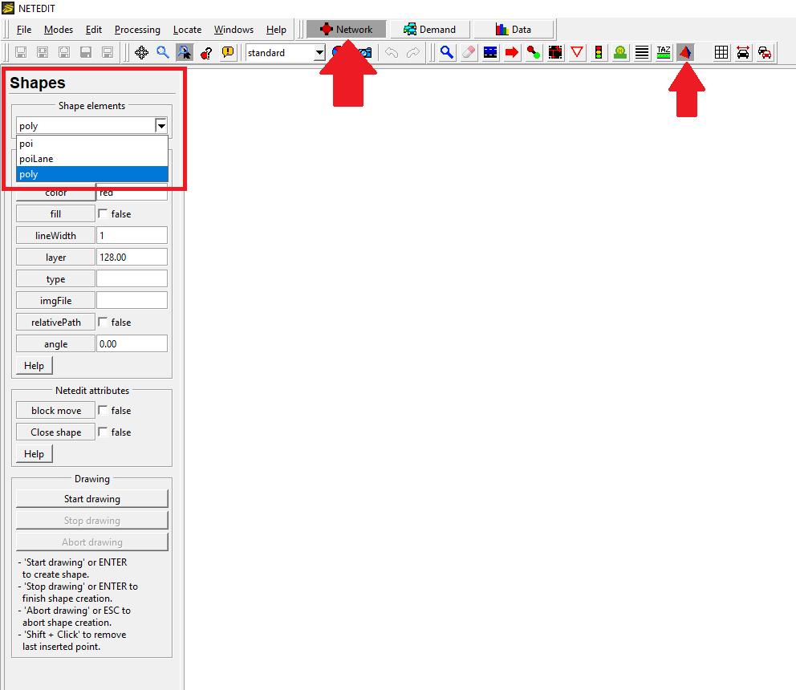
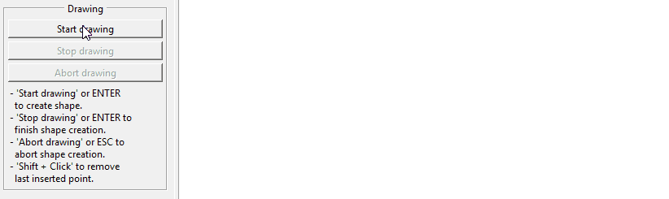

# Shape elements

Use **Network** supermode (<kbd>F2</kbd>) and **Polygon** mode  (<kbd>P</kbd>) to add polygons and points of interest (POIs). Select a shape type in the **Shapes** panel and set its attributes before placing it. Use [Inspect mode](editModesCommon.md#inspect) to change attributes after creation.

## Polygon

Select `poly`. Set the color and choose whether to fill the polygon. Use the close-shape option to join the last vertex to the first.

1. Click **Start drawing** or press <kbd>Enter</kbd>.
2. Click the map once for each vertex. Hold <kbd>Shift</kbd> and click to remove the last vertex.
3. Click **Stop drawing** or press <kbd>Enter</kbd> to finish. Click **Abort drawing** or press <kbd>Esc</kbd> to discard the unfinished shape.

Use [Move mode](editModesCommon.md#move) to adjust vertices. The polygon's context menu offers operations such as opening, closing, and simplifying the shape.

## POI

Select `poi` and click the map to place a marker in network coordinates. Set the color for a plain marker or specify an image with `imgFile`. The image settings include width, height, and angle.

For a location in geographic coordinates, select `poiGeo` in a network with a geographic projection. Click the map or use **GEO POI Creator** to enter the coordinates directly. Choose the coordinate order that matches your input, then click **Create GEO POI**.

## POI Lane

Select `poiLane` and click the target lane. NETEDIT records the lane ID and the distance from the start of the lane. You can set `posLat` for a lateral offset from the lane center.

To move an existing marker onto a lane, right-click it and choose **Attach to nearest lane**. For a lane-based marker, **Release from lane** keeps the marker at its current location in network coordinates.

## Loading and saving shapes

Choose **File → Additionals and Shapes → Load Additionals...** (<kbd>Ctrl</kbd>+<kbd>A</kbd>) to import shapes. Choose **Save Additionals** (<kbd>Ctrl</kbd>+<kbd>Shift</kbd>+<kbd>A</kbd>) from the same submenu to save them. See [shape XML definitions and simulation options](../Simulation/Shapes.md).
