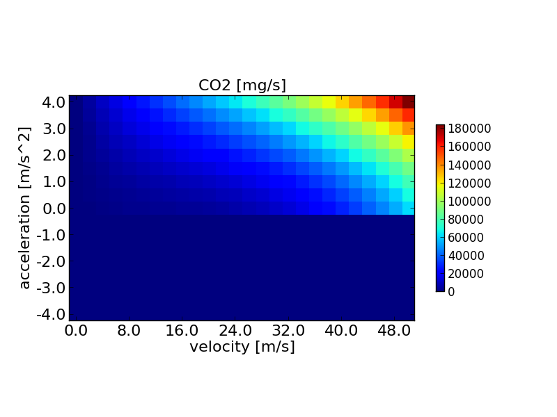

SUMO includes some small-sized tools and tests that help to develop and
evaluate the implemented [emission
models](../Topics/Environmental_Issues.md#models). These tools are
presented in the following.

# emissionsMap

This tool generates matrices of emissions for a given range of
velocities, accelerations, and slopes, given the vehicle's emission
class mainly.



The tool obtains parameters that describe the ranges and the emission classes to generate. If the option **--iterate** {{DT_BOOL}} is set, emissionsMap iterates over all available emission classes. In this case, the option **--output-file** {{DT_PATH}} should denote a folder the emission maps shall be written into. If **--iterate** {{DT_BOOL}} is not set, **--output-file** {{DT_FILE}} should name the file to generate and the emission class to write the map for must be defined using **--emission-class** {{DT_STR}} (or via a `<vType>` loaded with **--additional-files** {{DT_FILE}} and optional **--vtype** {{DT_STR}}). Vehicle type parameters such as mass or [electric vehicle parameters](../Models/Electric.md#defining_electric_vehicles) can also be supplied via **--additional-files** and **--vtype**. If PHEMlight shall be used, one can define the path to the CEP-files using **--phemlight-path** {{DT_PATH}}.

The tool is located in {{SUMO}}/bin.

The image shows the visualization of CO2 emission of the [HBEFA v2.1-based](../Models/Emissions/HBEFA-based.md) "P_7_6" emission class.


## Options

### Input

| Option | Description |
|--------|-------------|
| **--additional-files** {{DT_FILE}} | Load emission parameters (`vType` definitions) from FILE(s). |
| **--vtype** {{DT_STR}} | Defines the vehicle type ID to use for emission parameters (optional if **--additional-files** defines a single `vType`). |

### Processing

| Option                                   | Description                                                                                |
|------------------------------------------|--------------------------------------------------------------------------------------------|
| **-i** {{DT_BOOL}}<br>**--iterate** {{DT_BOOL}}            | If set, maps for all available emissions are written                                       |
| **-e** {{DT_STR}}<br>**--emission-class** {{DT_STR}} | Defines the name of the emission class to generate the map for                             |
| **--v-min** {{DT_FLOAT}}                          | Defines the minimum velocity boundary of the map to generate (in [m/s]); *default: **0***        |
| **--v-max** {{DT_FLOAT}}                          | Defines the maximum velocity boundary of the map to generate (in [m/s]); *default: **50***       |
| **--v-step** {{DT_FLOAT}}                         | Defines the velocity step size (in [m/s]); *default: **2***                                      |
| **--a-min** {{DT_FLOAT}}                          | Defines the minimum acceleration boundary of the map to generate (in [m/s^2]); *default: **-4*** |
| **--a-max** {{DT_FLOAT}}                          | Defines the maximum acceleration boundary of the map to generate (in [m/s^2]); *default: **4***  |
| **--a-step** {{DT_FLOAT}}                         | Defines the acceleration step size (in [m/s^2]); *default: **.5***                               |
| **--s-min** {{DT_FLOAT}}                          | Defines the minimum slope boundary of the map to generate (in [°]); *default: **-10***           |
| **--s-max** {{DT_FLOAT}}                          | Defines the maximum slope boundary of the map to generate (in [°]); *default: **10***            |
| **--s-step** {{DT_FLOAT}}                         | Defines the slope step size (in [°]); *default: **1***                                           |

### Output

| Option                            | Description                                                                  |
|-----------------------------------|------------------------------------------------------------------------------|
| **-o** {{DT_FILE}}<br>**--output-file** {{DT_FILE}} | Defines the file (or the path if **--iterate** was set) to write the map(s) into |

The format of the output is a CSV-like with **;** as the column
separator:

```
<speed>;<acceleration>;<slope>;<Pollutant-Type>;<Polutant-Value-in-mg/s-or-ml/s>
```

### Emissions

| Option | Description |
|--------|-------------|
| **--emissions.volumetric-fuel** {{DT_BOOL}} | Return fuel consumption values in (legacy) unit l instead of mg; *default: **false*** |
| **--phemlight-path** {{DT_PATH}} | Determines where to load [PHEMlight](../Models/Emissions/PHEMlight.md) definitions from; *default: **./PHEMlight/*** |
| **--phemlight-year** {{DT_INT}} | Enable fleet age modeling with the given reference year in PHEMlight5; *default: **0*** |
| **--phemlight-temperature** {{DT_FLOAT}} | Set ambient temperature to correct NOx emissions in PHEMlight5 |

### Report

| Option                        | Description                                |
|-------------------------------|--------------------------------------------|
| **-v** {{DT_BOOL}}<br>**--verbose** {{DT_BOOL}} | Switches to verbose output; *default: **false*** |
| **-?** {{DT_BOOL}}<br>**--help** {{DT_BOOL}}    | Prints the help screen                     |

# emissionsDrivingCycle

This tool computes emissions given a timeline of speeds/accelerations
for a single vehicle (via **--timeline-file** {{DT_FILE}}) or trajectories from a netstate, route, or Amitran file (via **--netstate-file** {{DT_FILE}}). Vehicle-specific emission and energy parameters (such as mass, power, recuperation, or [electric vehicle parameters](../Models/Electric.md#defining_electric_vehicles)) can be loaded from `<vType>` definitions using **--additional-files** {{DT_FILE}} and selected with **--vtype** {{DT_STR}} (optional when **--additional-files** contains only one `<vType>`; if **--emission-class** is not explicitly set, the `emissionClass` of the selected `<vType>` is used).

When using **--timeline-file** {{DT_FILE}}, the driving cycle is read from a `;`-separated CSV file (customizable via **--timeline-file.separator**; header lines can be skipped via **--timeline-file.skip** or **--skip-first**) with the following
columns:

- time (in \[s\]); if only a single column is present per line, it is interpreted as velocity and time increases in steps of 1 s starting from 0
- velocity (in \[m/s\] unless **--kmh** is set, see below)
- acceleration (in \[m/s^2\]); this column may be omitted when recalculated using **--compute-a** or **--compute-a.forward**
- optional: slope (in \[°\]); if given, one has to enable it using the
  option **--have-slope**

The tool generates a `;`-separated `.csv` file which contains the
following columns by default (configurable via **--output.attributes**):

- time (in \[s\])
- velocity (in \[m/s\])
- acceleration (in \[m/s^2\])
- slope (in \[°\])
- CO emissions (in \[mg/s\])
- CO2 emissions (in \[mg/s\])
- HC emissions (in \[mg/s\])
- PMx emissions (in \[mg/s\])
- NOx emissions (in \[mg/s\])
- fuel consumption (in \[mg/s\], or \[ml/s\] if **--emissions.volumetric-fuel** is set)
- electricity consumption (in \[Wh/s\])
- optional: coasting deceleration (in \[m/s^2\], included when `amount` or `all` is passed to **--output.attributes**)

Additionally, per-vehicle XML emission output can be written via **--emission-output** {{DT_FILE}}, aggregated and distance-normed CSV totals via **--sum-output** {{DT_FILE}}, and the sums of the generated emissions / consumed fuel
are printed on the screen unless **--quiet** is set.

The tool is located in {{SUMO}}/bin.

## Options

### Input

| Option | Description |
|--------|-------------|
| **-t** {{DT_FILE}}<br>**--timeline-file** {{DT_FILE}} | Defines the file to read the driving cycle from. |
| **--timeline-file.skip** {{DT_INT}} | Skips the first NUM lines of the timeline file; *default: **0*** |
| **--timeline-file.separator** {{DT_STR}} | Defines the entry separator in the timeline file; *default: **;*** |
| **-n** {{DT_FILE}}<br>**--netstate-file** {{DT_FILE}} | Defines the netstate, route, and trajectory (Amitran) files to read the driving cycles from. |
| **--additional-files** {{DT_FILE}} | Load emission parameters (`vType` definitions) from FILE(s). |
| **-e** {{DT_STR}}<br>**--emission-class** {{DT_STR}} | Defines for which emission class the emissions shall be generated; *default: **HBEFA4/default*** |
| **--vtype** {{DT_STR}} | Defines the vehicle type ID to use for emission parameters (requires **--additional-files**; optional when a single `vType` is loaded). |

### Processing

| Option | Description |
|--------|-------------|
| **-a** {{DT_BOOL}}<br>**--compute-a** {{DT_BOOL}} | If set, the acceleration is computed instead of being read from the file; *default: **false*** |
| **--compute-a.forward** {{DT_BOOL}} | If set, the acceleration for time `t` is computed from `v(t+1) - v(t)` instead of `v(t) - v(t-1)`; *default: **false*** |
| **--compute-a.zero-correction** {{DT_BOOL}} | If set, the acceleration for time `t` is set to 0 if the speed is 0; *default: **false*** |
| **-s** {{DT_BOOL}}<br>**--skip-first** {{DT_BOOL}} | If set, the first line of the read file is skipped; *default: **false*** |
| **--kmh** {{DT_BOOL}} | If set, the given speed is interpreted as being given in km/h; *default: **false*** |
| **--have-slope** {{DT_BOOL}} | If set, the fourth column is read and used as slope (in [°]); *default: **false*** |
| **--slope** {{DT_FLOAT}} | Sets a global slope (in [°]) that is used if the file does not contain slope information; *default: **0*** |
| **--begin** {{DT_TIME}} | Defines the begin time in seconds; *default: **0*** |
| **--end** {{DT_TIME}} | Defines the end time in seconds; *default: **-1*** |

### Output

| Option | Description |
|--------|-------------|
| **-o** {{DT_FILE}}<br>**--output-file** {{DT_FILE}} | Defines the file to write the emission cycle results into. |
| **--output.attributes** {{DT_STR_LIST}} | Defines the attributes to write (`speed`, `acceleration`, `slope`, `CO_abs`, `CO2_abs`, `HC_abs`, `PMx_abs`, `NOx_abs`, `fuel_abs`, `electricity_abs`, `amount`, or `all`). |
| **--emission-output** {{DT_FILE}} | Save the emission values of each vehicle in XML format. |
| **--sum-output** {{DT_FILE}} | Save the aggregated and distance-normed emission values of each vehicle in CSV format. |

### Emissions

| Option | Description |
|--------|-------------|
| **--emissions.volumetric-fuel** {{DT_BOOL}} | Return fuel consumption values in (legacy) unit l instead of mg; *default: **false*** |
| **--phemlight-path** {{DT_PATH}} | Determines where to load [PHEMlight](../Models/Emissions/PHEMlight.md) definitions from; *default: **./PHEMlight/*** |
| **--phemlight-year** {{DT_INT}} | Enable fleet age modeling with the given reference year in PHEMlight5; *default: **0*** |
| **--phemlight-temperature** {{DT_FLOAT}} | Set ambient temperature to correct NOx emissions in PHEMlight5 |

### Report

| Option                      | Description                                                 |
|-----------------------------|-------------------------------------------------------------|
| **-q** {{DT_BOOL}}<br>**--quiet** {{DT_BOOL}} | When set, the tool does not report anything; *default: **false*** |
| **-?** {{DT_BOOL}}<br>**--help** {{DT_BOOL}}  | Prints the help screen                                      |

<div style="border:1px solid #909090; min-height: 35px;" align="right">
<span style="float: right; margin-top: -5px;"><a href="https://web.archive.org/web/20191005024529/https:/ec.europa.eu/research/fp7/index_en.cfm"></a>
<a href="http://web.archive.org/web/20240722054138/https://verkehrsforschung.dlr.de/en/projects/colombo"></a></span>
<span style="">This part of SUMO was developed, reworked, or extended within the project
<a href="http://web.archive.org/web/20240722054138/https://verkehrsforschung.dlr.de/en/projects/colombo">"COLOMBO"</a>, co-funded by the European Commission within the <a href="https://web.archive.org/web/20191005024529/https:/ec.europa.eu/research/fp7/index_en.cfm">Seventh Framework Programme</a>.</span></div>
