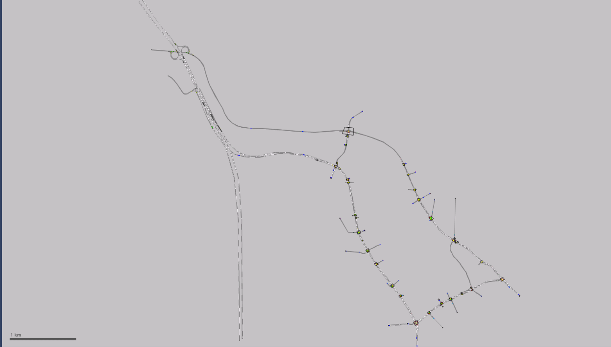
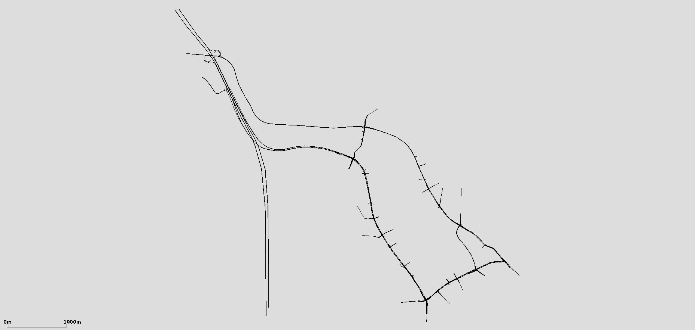
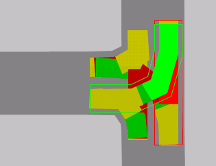
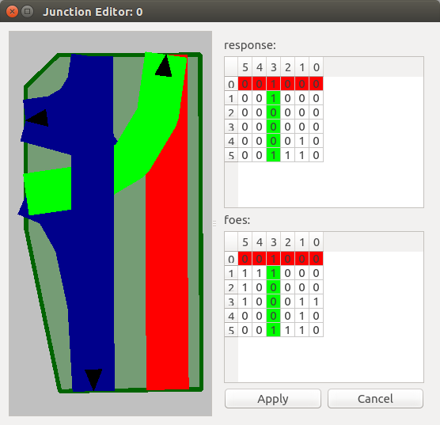
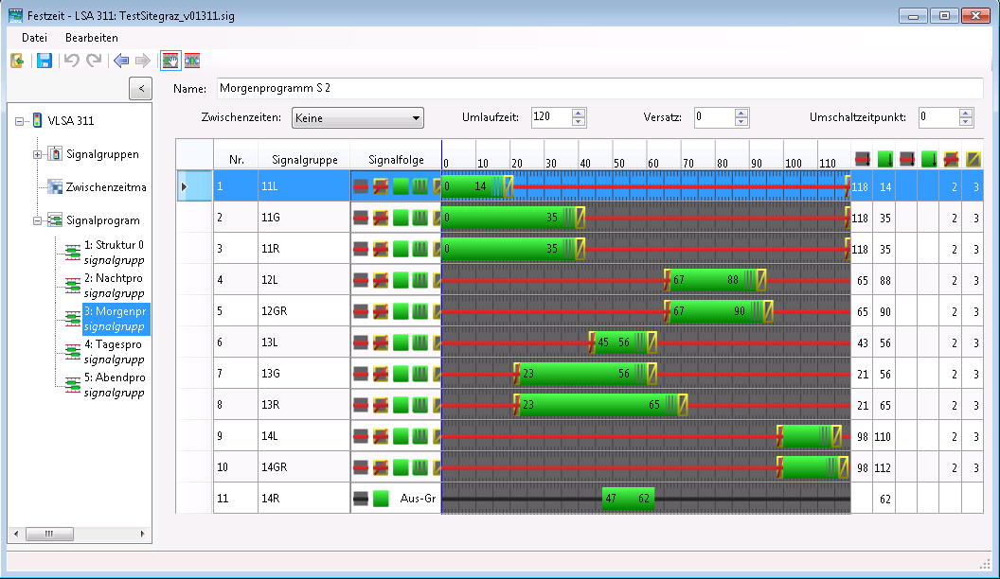
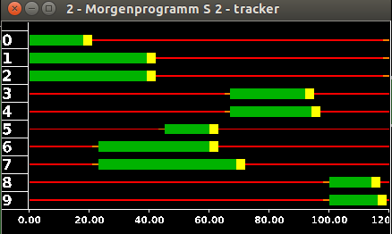

Extension tools for importing features from VISSIM `*.inpx` files

# Extending SUMO network conversion

With version 6 of PTV's commercial traffic microsimulation software, which is used to visualize traffic behavior not only in German-speaking countries, the file format was changed to an XML-based `.inpx` format. However, the SUMO tool `netconvert`, which converts networks from other source formats into a SUMO network, was still based on the old `.inp` format through version 0.23.0. A newer version is therefore required to convert current networks in the `.inpx` format. Since nothing in the program workflow has changed apart from reading the network information, the procedure for using `netconvert` to convert VISSIM networks remains the same.

During conversion of `.inpx` networks, priority rules within SUMO junctions are also defined by reading the conflict-area definitions from VISSIM.

In addition, Python tools were developed for the XML-based `.inpx` format. After the raw network information has been converted, these tools can import routes, vehicle flows, traffic lights, and detectors.

## Usage

Run `netconvert` for VISSIM networks as follows:

```
netconvert --vissim-file <VISSIM_FILE> –-output-file MySUMOFile.net.xml
```

The conversion process determines whether the VISSIM network uses the new `inpx` format or the old `inp` format. Users therefore do not need to know which version the VISSIM network uses. However, if you want to use the additional Python tools to convert data beyond the network itself, the network must be in `.inpx` format.

## Examples

Depending on the complexity of the network, additional adjustments may be necessary after conversion. The following figures show an example of converting an `.inpx` network to a SUMO network.




The figure "Junction conversion" shows a complex intersection created in VISSIM and then converted to SUMO. The figure shows that the geometry (and turning relationships) are translated correctly.


## Priorities based on VISSIM conflict areas

To verify the conversion of conflict areas, a VISSIM intersection was created that contradicts the usual priority rules for right-hand traffic. The VISSIM network was then converted to a SUMO network using `netconvert`. The figures "Conflict areas" show that the priority given to left-turning vehicles over through traffic was translated correctly.

**Conflict areas**




The data for the situation shown can be found in the test data directory at `tests/netconvert/import/leftist_conflictarea-prio/`. A corresponding `README.md` file is also located there.

# Converting routes and vehicle flows

Route and vehicle-flow definitions are an essential part of a simulation. The Python tool `convert_vissimXML_flows_statRoutes.py` parses VISSIM routes and vehicle flows and uses that information to create a SUMO route file for the converted network. This file has the extension `.rou.xml` and is specified as an argument when running the simulation. Conversion supports **only static route definitions** that specify an exact route sequence. Run the tool as follows:

```
convert_vissimXML_flows_statRoutes.py -V <vissim-file> -n <sumo-net-file> -o <output-filename>
```

## VISSIM route definitions

Vehicle flows are identified in the `.inpx` file by the XML tag `<timeIntervalVehVolume>`. Each vehicle flow is assigned to a link and is defined by a name (which may be empty) and a unique ID. Because the vehicle flow rate can change over time, time intervals are added to a flow and defined by the vehicle composition and traffic volume. The start times of the intervals are specified in milliseconds, and traffic volume is measured in vehicles per hour (veh/h). A vehicle-flow definition in VISSIM looks like this:

```xml
<vehicleInput anmFlag="false" link="9" name="Parkplatz 30221" no="1">
   <timeIntVehVols>
      <timeIntervalVehVolume cont="false" timeInt="1 0" vehComp="6" volType="STOCHASTIC" volume="48.000000"/>
      <timeIntervalVehVolume cont="false" timeInt="1 900000" vehComp="6" volType="STOCHASTIC" volume="84.000000"/>
      <timeIntervalVehVolume cont="false" timeInt="1 1800000" vehComp="6" volType="STOCHASTIC" volume="120.040000"/>
      <timeIntervalVehVolume cont="false" timeInt="1 2700000" vehComp="6" volType="STOCHASTIC" volume="120.040000"/>
   </timeIntVehVols>
</vehicleInput>
```

In VISSIM, route decisions are grouped by their starting points. Multiple static routes can start from a single link and lead to different destination links. The destination is specified by the `destLink` attribute. As with vehicle flows, time intervals are defined for each route; these specify the relative shares of the flow assigned to each route. The route itself is specified by the sequence of links introduced by the XML tag `<linkSeq>`. The following example shows a route definition:

```xml
<vehicleRoutingDecisionStatic allVehTypes="true" anmFlag="false" combineStaRoutDec="false" link="9" name="Parkplatz 30221" no="1" pos="1.000000">
     <vehicleRouteStatic destLink="205" destPos="20.916000" name="" no="113" relFlow="2 0:4.000000, 2 900000:6.990000, 2 1800000:9.990000, 2 2700000:9.990000, 2 3600000:12.660000, 2 4500000:16.330000, 2 5400000:20.990000, 2 6300000:15.660000, 2 7200000:16.660000, 2 8100000:16.330000">
        <linkSeq>
           <intObjectRef key="10381"/>
           <intObjectRef key="269"/>
           <intObjectRef key="10154"/>
           <intObjectRef key="117"/>
           <intObjectRef key="10150"/>
           <intObjectRef key="76"/>
           <intObjectRef key="10145"/>
        </linkSeq>
     </vehicleRouteStatic>
  </vehicleRoutingDecisionStatic>
```

## SUMO route definitions

In SUMO, multiple routes can be grouped into a route distribution, as in VISSIM, with all routes sharing a common starting point. Each route in the distribution is defined by its sequence of edges and its probability. The probabilities of all routes must sum to 1. A route distribution is referenced by its unique ID:

```xml
<routeDistribution id="81_900.0">
   <route edges="81 83 210 211 268 117 76 115 213 212 114 265 203 204 263 109 52 188 297 190 296 186 70 298 238 299 124" id="163" probability="0.372751499001"/>
   <route edges="81 83 210 211 268 117 76 115 213 212 114 265 203 204 263 109 52 188 297 190 296 186 70 298 238 299 239 72 " id="181" probability="0.125916055963"/>
   <route edges="81 83 210 211 268 117 76 115 213 212 114 265 203 204 263 109 52 188 297 190 296 186 181 184" id="187" probability="0.171219187209"/>
   <route edges="81 83 215 216 217 272 16" id="193" probability="0.211192538308"/>
   <route edges="81 83 210 211 268 13" id="195" probability="0.11892071952"/>
</routeDistribution>
```

Vehicle-type distributions are also part of a route definition. They specify the properties and probabilities of the defined vehicle types, which must be defined beforehand. As with route distributions, vehicle-type distributions are referenced by their unique ID:

```xml
<vTypeDistribution id="6">
   <vType accel="3.500000" id="t1001_D6" length="4.454081632653061" maxSpeed="14.722222222222221" probability="0.900000"/>
   <vType accel="7.300000" id="t1002_D6" length="10.086636363636364" maxSpeed="14.722222222222221" vClass="truck" probability="0.100000"/>
</vTypeDistribution>
```

Vehicle flows are also defined in the route file. As in VISSIM, each flow is specified for a particular time interval. It is important to **sort flows in ascending order by time**; otherwise, they may not be read correctly. Each flow is also assigned a previously defined route distribution, a vehicle-type distribution, and an ID. SUMO flows are defined as follows:

```xml
<flow begin="0.0" color="1,1,0" end="900.0" id="fl81_st0.0" route="81_0.0" type="6" vehsPerHour="94.56"/>
<flow begin="900.0" color="1,1,0" end="1800.0" id="fl81_st900.0" route="81_900.0" type="6" vehsPerHour="120.08"/>
<flow begin="1800.0" color="1,1,0" end="2700.0" id="fl108_st1800.0" route="108_1800.0" type="6" vehsPerHour="161.88"/>
```

General information on defining routes and vehicle flows is available here: [Definition of Vehicles, Vehicle Types, and Routes](../../Definition_of_Vehicles,_Vehicle_Types,_and_Routes.md)

## Implementation

The `convert_vissimXML_flows_statRoutes.py` tool imports the following VISSIM attributes:

- Static route decisions
- Vehicle flows
- Vehicle types
  - Speed
  - Length
  - Maximum acceleration
  - Vehicle composition

In VISSIM, speed, acceleration, and length are represented as probability distributions, so their mean values must first be calculated from the data. Note also that vehicle flows are sorted by time to ensure correct conversion. The chronological order must therefore also be maintained when editing flows. The tool creates a `.rou.xml` file containing all route information required for a SUMO simulation. This file must then be added to the SUMO configuration file.

# Converting traffic-light programs

The additional tool `tls_vissimXML2SUMO.py` parses VISSIM traffic lights and adds this information to the converted SUMO network. Run it as follows:

```
tls_vissimXML2SUMO.py -V <vissim-file> -S <sumo-file> -o <output-filename>
```

## Traffic-light definitions in VISSIM

In VISSIM, an additional `.sig` file is created for each traffic light. It contains all relevant information about the defined signal programs, such as the signal sequence and signal order. The remaining traffic-light definitions are stored in the network's existing `.inpx` file. The following example illustrates the structure of these files.

### `.inpx` file

In the `.inpx` file, traffic lights are identified by the XML tag `<signalController>`. The attributes required for conversion to SUMO format are the associated `.sig` file and the list of defined signal groups. Signal groups can be assigned to multiple lanes and are defined by a signal sequence. These sequences appear as an attribute of the child element `<signalOutputConfigurationElement>`. A traffic-light definition in VISSIM looks like this:

```xml
<signalController active="true" cycTm="0.000000" cycTmIsVar="true" debug="false" guiFile="VISSIG_GUI.dll" name="VLSA 301 (WienerStr./JudendorferStr.)" no="301" offset="0.000000" progFile="VISSIG_Controller.dll" progNo="1" scDetRecFile="VISSIM_302.ldp" scDetRecShortNam="false" sigTmsTabAutoConfig="true" supplyFile1="vissig.config" supplyFile2="TestsiteGraz_v01301.sig" supplyFile3="" type="FIXEDTIME">
    <sGs>
        <signalGroup amber="0.000000" greenFlsh="0.000000" minGreen="0.000000" minRed="0.000000" name="11GR" no="1" redAmber="0.000000" type="NORMAL"/>
        < ... >
        <signalGroup amber="0.000000" greenFlsh="0.000000" minGreen="0.000000" minRed="0.000000" name="14R" no="8" redAmber="0.000000" type="NORMAL"/>
     </sGs>
     <wttFiles>
        <intObjectRef key="1"/>
     </wttFiles>
     <sigTmsTabConfig>
        <signalOutputConfigurationElement configName="SIGGRP" detPort="0" sg="301 1" title="" varNo="1" wttFilename="vissim"/>
        <signalOutputConfigurationElement configName="SIGGRP" detPort="0" sg="301 2" title="" varNo="2" wttFilename="vissim"/>
     </sigTmsTabConfig>
  </signalController>
```

The `.inpx` file also contains the definitions of the signal heads for all traffic lights. Each signal head is assigned to a lane on a link and belongs to a previously defined signal group:

```xml
<signalHeads>
     <signalHead allPedTypes="true" allVehTypes="true" complRate="1.000000" dischRecAct="false" isBlockSig="false" lane="223 1" localNo="6" name="" no="1" pos="98.115000" sg="305 6" slowDownDist="3.000000" type="CIRCULAR" vAmberBlock="0.000000"/>
     <signalHead allPedTypes="true" allVehTypes="true" complRate="1.000000" dischRecAct="false" isBlockSig="false" lane="276 3" localNo="5" name="" no="2" pos="82.377000" sg="305 5" slowDownDist="3.000000" type="CIRCULAR" vAmberBlock="0.000000"/>
  </signalHeads>
```

### `.sig` file

Signal phases are referenced by ID in the `.sig` file. The mapping between IDs and phases is defined at the beginning of the file as follows:

```xml
 <signaldisplays>
     <display id="1" name="Red" state="RED"/>
     <display id="2" name="Red/Amber" state="REDAMBER"/>
  </signaldisplays></source>
```

</source>

VISSIM also uses fixed signal sequences to define a signal program. These are also located near the beginning of the `.sig` file. They define the order of the phases, which are referenced by their respective IDs:

```xml
<signalsequences>
   <signalsequence id="5" name="Red-Red/Amber-Green-Flashing Green-Amber">
      <state display="1" isFixedDuration="false" isClosed="true" defaultDuration="1000" />
      <state display="2" isFixedDuration="true" isClosed="true" defaultDuration="1000" />
      <state display="3" isFixedDuration="false" isClosed="false" defaultDuration="5000" />
      <state display="5" isFixedDuration="true" isClosed="false" defaultDuration="4000" />
      <state display="4" isFixedDuration="true" isClosed="true" defaultDuration="3000" />
   </signalsequence>
   <signalsequence id="12" name="Off-Green">
      <state display="7" isFixedDuration="false" isClosed="true" defaultDuration="1000" />
      <state display="3" isFixedDuration="false" isClosed="false" defaultDuration="5000" />
   </signalsequence>
</signalsequences>
```

All signal programs and their cycle times are then defined:

```xml
<prog id="1" cycletime="80000" switchpoint="0" offset="13000" intergreens="0" fitness="0.000000" vehicleCount="0" name="Morgenprogramm S 2.7"/>
```

Signal groups are defined by the start times of the red and green phases and the durations of the remaining phases, which are specified in the corresponding signal sequence:

```xml
<sg sg_id="1" signal_sequence="5">
   <cmds>
      <cmd display="3" begin="13000" />
      <cmd display="1" begin="46000" />
   </cmds>
   <fixedstates>
      <fixedstate display="2" duration="2000" />
      <fixedstate display="5" duration="4000" />
      <fixedstate display="4" duration="3000" />
   </fixedstates>
</sg>
```

## Traffic-light definitions in SUMO

Unlike VISSIM, SUMO does not require a separate file for each traffic light. The definitions of all traffic lights and their programs are written to the existing network file, which also contains all graph information. The following explains an example of a SUMO traffic-light definition.

A traffic light is identified in the SUMO network file by the XML element `<tlLogic>`. The attributes `id`, `type`, `offset`, and `programID` can be specified, although conversion defines only `id` and `programID`. The traffic-light ID must match the ID of its associated junction (`junction id = tlLogic id`), and `programID` specifies the name of the signal program. The `type` attribute is always set to `"static"`, meaning that the phases have fixed durations. The traffic-light offset, specified by the `offset` attribute, is also always set to `0.00`. The child elements define the individual signal phases, each with a duration in seconds and a state. Each character in `states` defines the current state of a lane:

```xml
<tlLogic id="69" type="static" programID="Tagesprogramm S 5.3" offset="0.00">
   <phase duration="20.00" state="Grrr"/>
   <phase duration="20.00" state="yyyy"/>
   <phase duration="100.00" state="rGGG"/>
   <phase duration="100.00" state="yyyy"/>
</tlLogic>
```

The `linkIndex` attribute of the corresponding *connection* specifies which lane corresponds to each `state` index. In addition, every *connection* controlled by a traffic light must be assigned to that traffic light. To do this, set the `tl` attribute to the ID of the relevant traffic light:

```xml
<connection dir="r" from="117" fromLane="0" to="88" toLane="0" via=":69_1_0" tl="69" linkIndex="2" state="o"/>
<connection dir="s" from="117" fromLane="0" to="76" toLane="0" via=":69_2_0" tl="69" linkIndex="3" state="o"/>
<connection dir="s" from="117" fromLane="1" to="76" toLane="1" via=":69_2_1" tl="69" linkIndex="1" state="o"/>
<connection dir="r" from="89" fromLane="0" to="76" toLane="0" via=":69_0_0" tl="69" linkIndex="0" state="o"/>
```

The *junction* where the traffic light is placed must also be defined accordingly. This is done using the `type` attribute, which specifies the junction's control type. If a traffic light is assigned to a *junction*, its `type` must be set to `"traffic_light"`:

```xml
<junction id="69" incLanes="89_0 117_0 117_1" intLanes=":69_0_0 :69_1_0 :69_2_0 :69_2_1" shape="3276.61,1952.22 3277.64,1946.15 3275.74,1944.30 3269.32,1943.27 3265.23,1952.29 3274.96,1953.43" type="traffic_light" x="3273.91" y="1947.87">
   <request cont="0" foes="1100" index="0" response="1100"/>
   <request cont="0" foes="0000" index="1" response="0000"/>
   <request cont="0" foes="0001" index="2" response="0000"/>
   <request cont="0" foes="0001" index="3" response="0000"/>
</junction>
```

SUMO also allows multiple programs to be defined for one traffic light. This is done by defining a weekly switching schedule (WAUT). The `startProg` attribute specifies which program is selected at the start of the simulation. This initial program is taken from the VISSIM network's `.inpx` file, and signal programs are mapped using their program IDs. During the simulation, signal programs can be changed manually in the GUI or automatically at a specified time using the `<wautSwitch>` child element:

```xml
<WAUT refTime="0" id="myWAUT" startProg="weekday_night">
   <wautSwitch time="21600" to="weekday_day"/>
   <wautSwitch time="79200" to="weekday_night"/>
</WAUT>
```

More information about defining traffic lights is available here: [Traffic Lights](../../Simulation/Traffic_Lights.md).

## Implementation

Unlike the other tools, this tool must also read all `.sig` files that were automatically generated for each traffic light. As required by VISSIM, these files must be located in the same directory as the `.inpx` file. After all signal displays have been converted, the previously converted SUMO `.net` file is supplemented with the traffic-light information. All signal programs that can be switched between using the WAUT are read. The default program selected at the beginning of the simulation is defined in the VISSIM network's `.inpx` file and is imported from there.

## Example




The two signal programs shown here are compared using the graphical interfaces of VISSIM and SUMO. The figure shows that the converted signal groups match. However, VISSIM includes a flashing-green signal state that is not defined in SUMO, so it had to be simplified to green during conversion. The figure also shows that not all signal groups defined in VISSIM were imported into SUMO. These groups were defined in VISSIM but were not assigned to any link, so they have no effect on the simulation.

# Converting induction loops and travel-time measurements

The Python script `convert_detectors2SUMO.py` reads induction loops and travel-time measurements from a VISSIM network and imports them into the SUMO network previously converted by `netconvert`. Conversion creates an additional `.add.xml` file, which must then be added to the SUMO configuration file for the simulation. Run the script as follows:

```
convert_detectors2SUMO.py -V <vissim-file> -S <sumo-file> -o <output-filename>
```

## Detector definitions in VISSIM

Cross-section measurements are identified in VISSIM by the XML tag `<dataCollectionPoint>`. Each detector's position is specified by the lane on the link and its distance along that lane:

```xml
<dataCollectionPoint lane="108 1" name="301.41" no="1" pos="162.558473"/>
<dataCollectionPoint lane="262 4" name="301.12" no="10" pos="32.960054"/>
```

Travel-time measurements in VISSIM are defined for links, not individual lanes. The link and distance along it are specified for both the start and end points:

```xml
<vehicleTravelTimeMeasurement name="Wienerstrasse_Sueden" no="1">
   <start link="207" pos="239.836000"/>
   <end link="126" pos="12.867000"/>
</vehicleTravelTimeMeasurement>
```

## Detector definitions in SUMO

Induction loops in SUMO are defined similarly to cross-section measurements in VISSIM. Their positions are also specified by lane and distance along the lane. However, SUMO additionally allows you to define the time interval over which the data are aggregated.

```xml
<inductionLoop file="ind_out.xml" period="900" id="1_301.41" lane="108_0" pos="162.554736186"/>
<inductionLoop file="ind_out.xml" period="900" id="33_359.21" lane="123_0" pos="28.1962390136"/>
```

As with induction loops, travel-time measurements are defined by their aggregation interval and position. Unlike VISSIM, however, a SUMO travel-time measurement does not have to cover an entire link, because the lanes to be included can be specified.

```xml
<entryExitDetector file="time_out.xml" period="900" id="1">
   <detEntry lane="207_0" pos="239.753789696"/>
   <detEntry lane="207_1" pos="241.370532161"/>
   <detExit lane="126_0" pos="23.2884507277"/>
   <detExit lane="126_1" pos="23.2873152316"/>
</entryExitDetector>
```

## Implementation

During network conversion, connecting links from VISSIM are combined into SUMO *junctions*, so link lengths are not preserved exactly. As a result, the distances along the links no longer match. Detector coordinates are therefore obtained from VISSIM and then transformed into SUMO coordinates. To determine the distance along the link in SUMO, the point on the link closest to the previously obtained coordinates is then found.

Another issue with converting travel-time measurements is that measurements must always define a closed interval, which is not required in VISSIM. This can cause errors during simulation if vehicles pass the end point of a travel-time measurement without ever having passed its start point.
