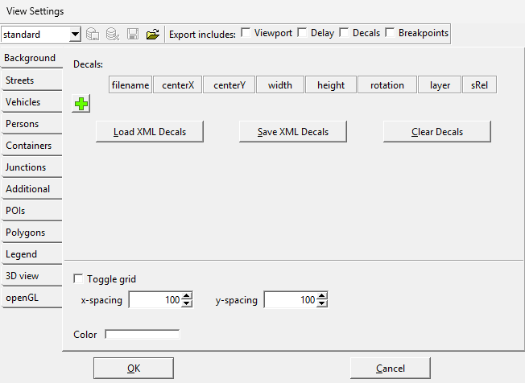
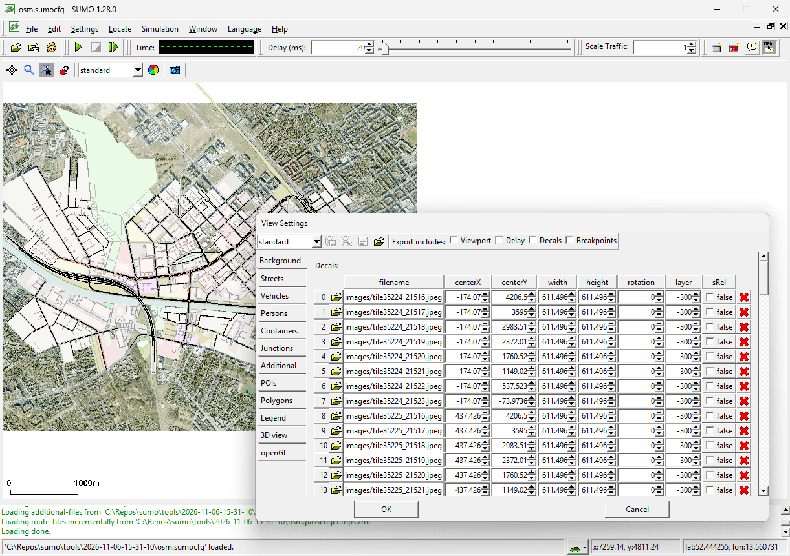

# View Settings

The View Settings dialog controls how [sumo-gui](sumo-gui.md) and [NETEDIT](Netedit/index.md) draw the network and its objects. Press <kbd>F9</kbd> or click  in the view toolbar to open it.

Use the drop-down list at the top of the dialog to choose a visualization scheme. The tabs group settings by object type. Use the toolbar to save a scheme to the registry , delete a saved scheme , export a [settings file](sumo-gui.md#gui-settings_files) , or load an existing file .

## Common Visualization Settings

Separate settings exist for different simulation objects such as
vehicle, lanes, persons and detectors. Some options exist for all (or
most) of these objects:

- Size options
  - *Exaggerate by*: Draws objects bigger to make them more visible
  - *Minimum Size*: Do not draw objects below a minimum size
  - *Draw with constant size when zoomed out*: Automatically
    increase the drawing size when zooming out to keep the visual
    size constant.
- id options
  - *Show id*: Enable drawing of object IDs
  - *constant text size*: toggle whether the visual text size will stay constant when zooming
  - *Size*: Size of the drawn ID
  - *Color*: Color of drawn ID
  - *Background*: Background color of drawn ID
  - *Show name*: Show optional name (either using the 'name' attribute or 'name' `<param>`)
- Coloring options: Color by some attribute and change the color
value/range
  - Show color value: show the numerical value that is used for
    coloring (text configuration options as for the id)

## Vehicle Visualization Settings

### Vehicle shape schemes

| Name          | Description                                                                                                                      |
| ------------- | -------------------------------------------------------------------------------------------------------------------------------- |
| triangle      | All vehicles are shaped triangular                                                                                               |
| boxes         | All vehicles are shaped square                                                                                                   |
| simple shapes | All vehicles have simple car shape                                                                                               |
| raster images | All vehicles are drawn with a loaded bitmap defined for their type using attribute `imgFile` (using *simple shapes* as fallback) |

!!! note
    When using an `imgFile` as the shape, it is necessary to select the vehicles to show as "raster images" in the *View Settings* menu.

### Vehicle coloring schemes

| Name                           | Measure | Description         |
| ------------------------------ | ------- | ----------------------------------------------------------------------------------------------------------------------------- |
| given vehicle/type/route color | \-      | The color given within the vehicle definition with fallback to type and then to route color                                                                                                                   |
| uniform                        | \-      | All vehicles are colored uniformly                                                                                                                                                                            |
| given/assigned vehicle color   | \-      | The color given within the vehicle definition                                                                                                                                                                 |
| given/assigned type color      | \-      | The color given within the vehicle type definition                                                                                                                                                            |
| given/assigned route color     | \-      | The color given within the vehicle route definition                                                                                                                                                           |
| depart position as HSV         | \-      | The depart position of each vehicle, relative to the network center, is used to color the vehicle. Direction will be used as H(ue), distance from the center as S(aturation), V(alue) is always 1.            |
| arrival position as HSV        | \-      | The arrival position of each vehicle, relative to the network center, is used to color the vehicle. Direction will be used as H(ue), distance from the center as S(aturation), V(alue) is always 1.           |
| direction/distance as HSV      | \-      | The direction and distance between a vehicle's departure and arrival position, are used to color the vehicle. Direction will be used as H(ue), distance from the center as S(aturation), V(alue) is always 1. |
| by speed                       | m/s     | The current vehicle speed                                                                                                                                                                                     |
| by action step                 | \-      | Action in current step, next stop or otherwise
| by waiting time                | s       | The time for which a vehicle is halting                                                                                                                                                                       |
| by accumulated waiting time    | s       | The total time for which a vehicle has been halting recently (default: within the last 300s.)                                                                                                                 |
| by time since last lanechange  | s       | The time since the last lane change. The color also indicates the direction of the last lane-change (negative values indicated a change to the right).                                                        |
| by max speed                   | m/s     | Vehicle's maximum velocity                                                                                                                                                                                    |
| by CO2 emissions               | g/s     | The amount of CO2 currently emitted by the vehicle                                                                                                                                                            |
| by CO emissions                | g/s     | The amount of CO currently emitted by the vehicle                                                                                                                                                             |
| by PMx emissions               | g/s     | The amount of PMx currently emitted by the vehicle                                                                                                                                                            |
| by NOx emissions               | g/s     | The amount of NOx currently emitted by the vehicle                                                                                                                                                            |
| by HC emissions                | g/s     | The amount of HC currently emitted by the vehicle                                                                                                                                                             |
| by fuel consumption            | l/s     | The consumed fuel                                                                                                                                                                                             |
| by electricity consumption     | kWh/s   | The consumed electricity (for electric vehicles only)                                                                                                                                                         |
| by noise emissions             | dbA     | The noise produced by the vehicle                                                                                                                                                                             |
| by reroute number              | count   | The number of times this vehicle has bee rerouted                                                                                                                                                             |
| by selection                   | \-      | Colors selected and unselected vehicles differently                                                                                                                                                           |
| by offset from best lane       | count   | The number of immediate lane changes the vehicle must perform in order to follow its route                                                                                                                 |
| by acceleration                | m/s^2   | The current vehicle acceleration                                                                                                                                                                                                              |
| by time gap                    | s       | The time to collide with the leader vehicle assuming constant speeds                                                                                                                                       |
| by depart delay                | s       | The difference of actual insertion time and intended depart time                                                                                                                                       |
| by time loss                   | s       | The total time loss from driving slower than desired since departure                                                                                                                                       |
| by stop delay                  | s       | The departure delay for next (or current) public transport stop (with defined 'until' time)                                                                                                                                        |
| by stop arrival delay          | s       | The arrival delay for next (or current) public transport stop (with defined 'arrival' time)                                                                                                                                        |
| by lateral speed               | m/s     | The lateral speed of the vehicle                                                                                                                                        |
| by param (numerical)           | value   | The numerical value of the given vehicle, [device or model](TraCI/Vehicle_Value_Retrieval.md#device_and_lanechangemodel_parameter_retrieval_0x7e) parameter                                                                                                                                       |
| random                         | \-      | Random vehicle color                                                                                                                                       |
| by angle                       | \-      | Color by heading angle of the vehicle                                                                                                                                       |

### Toggles

- Show blinkers / brake lights
- Show brake gap
- Show route index: When activating *show route* in the vehicle context menu, each highlighted edge is annotated with its index along the route (permitting to analyze looped routes)
- Show parking info: When activating *show route* in the vehicle context menu, the vehicle is annotated with the number of failed parking attempts and each parking area is annotated with the last target selection score
- Show minimum gap
- Show [Bluetooth range](Simulation/Bluetooth.md)
- Scale length with geometry (see [length-geometry-mismatch](Simulation/Distances.md#vehicle_lengths_in_sumo-gui))

### Scaling

Vehicle size is affected by the following features

- **Exaggerate by** : Sets a constant scaling factor
- **Draw with constant size when zoomed out**: Increases vehicle size (relative to road network) and thereby keeps them visible when zooming out
It is also possible to scale the size of the vehicle according its attributes.
- **Scale size**: Selects scaling by a given attribute (i.e. speed). The user may configure a table of scaling factors corresponding to a list of numerical values (with automatic interpolation). This works similar to color interpolation.
- **Scale length with geometry** : Deactivating this option makes a difference in networks with mismatching edge length values (e.g. given length value greater than the one derived from geometry) - vehicles can be drawn longer / shorter than they actually extend physically along the lane.

### Textual annotations

The following textual annotations are supported:

- **vehicle id**: Renders the vehicle id and also 'line' attribute if defined for the vehicle
- **vehicle color value**: The numerical value that forms the basis for coloring (i.e. speed) is rendered
- **vehicle scale value**: The numerical value that forms the basis for scaling (i.e. acceleration) is rendered. It may be useful to activate scaling just for the textual value (and setting a scaling factors to 1).
- **Vehicle text param**: Renders any [Generic Parameter](Simulation/GenericParameters.md) set on the vehicle. This also supports any [virtual parameters accessible via TraCI](TraCI/Vehicle_Value_Retrieval.md#device_and_lanechangemodel_parameter_retrieval_0x7e)


Each text can be configured with regard to its size color and background color. By activating the option *Only for selected*, The textual annotation is limited to vehicles with the [*selected*](sumo-gui.md#selecting_objects) status.

## Edge/Lane Visualization Settings

**Table 2.1 Lane coloring schemes**

| Name                                     | Measure | Description                                                                                   |
| ---------------------------------------- | ------- | ----------------------------------------------------------------------------------------------------------------------- |
| uniform                                  | \-      | All road edges are drawn using the same color. Bicycle lanes are drawn in brown, sidewalks in gray and prohibited lanes (allowing no vehicle classes) are transparent. |
| by selection (lane-/streetwise)          | \-      | selected lanes are drawn different than those that are not                                                                                                             |
| by permission code                       | \-      | all lanes are colored according to the permitted vehicle classes. The code for each lane can be retrieved from the lane parameter dialog (permission code).            |
| by allowed speed (lanewise)              | m/s     | The maximum velocity allowed on this lane                                                                                                                              |
| by current occupancy (lanewise, brutto)  | % / 100 | By the amount of place that is covered by vehicles (including minGap)                                                                                                  |
| by current occupancy (lanewise, netto)   | % / 100 | By the amount of place that is covered by vehicles (excluding minGap)                                                                                                  |
| by first vehicle waiting time (lanewise) | s       | By the time the first vehicle on the lane waits                                                                                                                        |
| by lane number (streetwise)              | \-      | By the number of lanes this edge has                                                                                                                                   |
| by CO2 emissions                         | g/s     | The mean amount of CO2 emitted per a lane's meter                                                                                                                      |
| by CO emissions                          | g/s     | The mean amount of CO emitted per a lane's meter                                                                                                                       |
| by PMx emissions                         | g/s     | The mean amount of PMx emitted per a lane's meter                                                                                                                      |
| by NOx emissions                         | g/s     | The mean amount of NOx emitted per a lane's meter                                                                                                                      |
| by HC emissions                          | g/s     | The mean amount of HC emitted per a lane's meter                                                                                                                       |
| by fuel consumption                      | l/s     | The mean amount of consumed fuel per a lane's meter                                                                                                                    |
| by electricity consumption               | kWh/s   | The mean amount of consumed electricity per a lane's meter                                                                                                             |
| by noise emission                        | dBa     | The noise generated by the vehicles on the lane                                                                                                                        |
| by global travel time                    | s       | The travel time on that edge loaded from a weight file                                                                                                                 |
| by global speed percentage               | %       | By the fraction of the maximum speed that the edge allows based on travel times from a loaded weight file                                                              |
| by given length/geometrical length       |         | The factor by which the geometrical length differs from the user-specified edge length                                                                                 |
| by angle                                 |         | The angle of the edge measured from start to end (excluding in-between geometry)                                                                                       |
| by loaded weight                         |         | By the value loaded using options **--weight-files, --weight-attribute**   |
| by priority                              |         | By the right-of-way priority using during network building                                                                                                             |
| by height at start                       | m       | By the z-coordinate at the start of the lane                                                                                                                           |
| by height at segment start               | m       | By the z-coordinate at the start of each geometry segment                                                                                                              |
| by inclination                           | %       | By the average change in height between start and end of the lane per m                                                                                                |
| by segment inclination                   | %       | By the average change in height between start and end of each geometry segment                                                                                         |
| by average speed                         | m/s     | By the average speed of vehicles on the lane                                                                                                                           |
| by average relative speed                | %       | By the average speed of vehicles on the lane as percentage of the allowed speed      |
| by routing device assumed speed          | m/s   | The averaged speed [computed by the rerouting device](Demand/Automatic_Routing.md#edge_weights) |
| by insertion backlog                     |       | The number of cars currently delayed for insertion on the lane     |
| by TAZ                                   |       | By the color of the TAZ to which this edge belongs (if [TAZs](Demand/Importing_O/D_Matrices.md#describing_the_taz) with colors are loaded) |
| by param (numerical, streetwise)         |       | By the edge parameter configured in the drop-down list of all known edge parameters.  |
| by param (numerical, lanewise)           |       | By the lane parameter configured in the drop-down list of all known lane parameters.  |
| by edgeData (numerical, streetwise)      |       | By the edgeData attribute configured in the drop-down list of all loaded edgeData attributes.  |
| by edgeData (numerical, streetwise)      |       | By the edgeData attribute configured in the drop-down list of all loaded edgeData attributes.  |
| by distance (kilometrage)                | m     | By the kilometrage value at start of the edge (negative values indicate falling kilometrage)   |
| by abs distance (kilometrage)            | m     | By the kilometrage value at start of the edge  |
| by reachability (traveltime)             | s     | Traveltime for reaching this edge from the most recently used 'selected reachability' location |
| by thread index                          |       | Index of the thread that is computing this lane (when running with option **--threads**) |
| free parking spaces                      |       | Total number of free parkingArea spaces on that edge |
| by live edgeData                         |       | By the selected attribute value of the selected meanData id being recorded in the current simulation (configuration via two drop-down lists) |

**Table 2.2 Lane scaling schemes**

| Name                                     | Measure | Description                                                                                               |
| ---------------------------------------- | ------- | --------------------------------------------------------------------------------------------------------- |
| by selection (lane-/streetwise)          | \-      | selected lanes are drawn different than those that are not                                                |
| by allowed speed (lanewise)              | m/s     | The maximum velocity allowed on this lane                                                                 |
| by current occupancy (lanewise, brutto)  | % / 100 | By the amount of place that is covered by vehicles (including minGap)                                     |
| by current occupancy (lanewise, netto)   | % / 100 | By the amount of place that is covered by vehicles (excluding minGap)                                     |
| by first vehicle waiting time (lanewise) | s       | By the time the first vehicle on the lane waits                                                           |
| by lane number (streetwise)              | \-      | By the number of lanes this edge has                                                                      |
| by CO2 emissions                         | g/s     | The mean amount of CO2 emitted per a lane's meter                                                         |
| by CO emissions                          | g/s     | The mean amount of CO emitted per a lane's meter                                                          |
| by PMx emissions                         | g/s     | The mean amount of PMx emitted per a lane's meter                                                         |
| by NOx emissions                         | g/s     | The mean amount of NOx emitted per a lane's meter                                                         |
| by HC emissions                          | g/s     | The mean amount of HC emitted per a lane's meter                                                          |
| by fuel consumption                      | l/s     | The mean amount of consumed fuel per a lane's meter                                                       |
| by electricity consumption               | kWh/s   | The mean amount of consumed electricity per a lane's meter                                                |
| by noise emission                        | dBa     | The noise generated by the vehicles on the lane                                                           |
| by global travel time                    | s       | The travel time on that edge loaded from a weight file                                                    |
| by global speed percentage               | %       | By the fraction of the maximum speed that the edge allows based on travel times from a loaded weight file |
| by given length/geometrical length       |         | The factor by which the geometrical length differs from the user-specified edge length                    |
| by angle                                 |         | The angle of the edge measured from start to end (excluding in-between geometry)                          |
| by loaded weight                         |         | By the value loaded using options **--weight-files, --weight-attribute**                                  |
| by priority                              |         | By the right-of-way priority using during network building                                                |
| by average speed                         | m/s     | By the average speed of vehicles on the lane                                                              |
| by average relative speed                | %       | By the average speed of vehicles on the lane as percentage of the allowed speed                           |

In addition to the lane / edge coloring one can display lane borders,
link decals, rails, edge names, street names, internal edge names, and
hide macro connectors. The edge names as well as the street and internal
edge names will always be scaled to the chosen size, no matter which
zoom step is chosen.

## Showing Background Images

In addition to changing the appearance of simulated structures, one may
also load additional background images ("decals") into
**sumo-gui**. For this, open the visualization
settings using  (or <kbd>F9</kbd>) and - if you are not yet here - choose the
"Background" panel (see Figure below). You will see a table with the following
columns: **filename**, **centerX**, **centerY**, **width**,
**height**, **rotation**, **layer** and **relative**.



**The decals GUI.**

Clicking the green plus button () adds a new row. In each row, you can select an image file using a file selection dialog or enter its path in the filename input field.

**sumo-gui** loads and displays the image files in a layer below the road network, as shown in the figure:



**Example of a background image (decal).**

Currently, **sumo-gui** may load .gif, .png, .jpeg and .bmp
files. If built with gdal-support further formats such as .tif are also
usable.

Now, you may position/stretch/rotate the image using the columns
**centerX**, **centerY**, **width**, **height**, and **rotation**.

When setting the column **relative** to *1*, position and size values
will be taken as screen-relative pixel values instead of
network-relative meter values.

After aligning your decals, you can save them using the "Save XML Decals"
button located in the dialog. Accordingly, previously saved decals can
be loaded by pressing the "Load XML Decals" button.

When defining decals in XML a single line which looks like this:

```xml
<decal file="background.gif" centerX="550.00" centerY="1530.00" width="64.00" height="64.00" rotation="0.00"/>
```

The following attributes are supported

| Attribute Name | Value Type    | Description                                                                                                                     |
| -------------- | ------------- | ------------------------------------------------------------------------------------------------------------------------------- |
| **file**       | path (string) | *picture file*, the full name of the background image                                                                           |
| **centerX**    | float         | *center x*, the x-position of the center of the image in network coordinates (in meters)                                        |
| **centerY**    | float         | *center y*, the y-position of the center of the image in network coordinates (in meters)                                        |
| **width**      | float         | The width of the image in network coordinates (in meters)                                                                       |
| **height**     | float         | The height of the image in network coordinates (in meters)                                                                      |
| rotation       | float         | The angle of the image in degrees                                                                                               |
| layer          | float         | The layer at which the image is drawn in meters over ground                                                                     |
| screenRelative | bool          | *relative*, whether the position and size are pixel coordinates relative to the screen rather then the network coordinates      |
| centerZ        | float         | The z-position of the center of the object in network coordinates (in meters), only used in 3D visualization instead of *layer* |
| tilt           | float         | The tilt angle of the object, only used in 3D visualization                                                                     |
| roll           | float         | The roll angle of the object, only used in 3D visualization                                                                     |

!!! note
    The contents of a decal-configuration can also be embedded in a view-settings file and thus loaded on startup. see [Configuration Files](sumo-gui.md#configuration_files)

!!! note
    When loading an image file with an embedded geo-reference (i.e. [GeoTIFF](https://en.wikipedia.org/wiki/GeoTIFF)) and the simulation network also has a geo-reference, then the image will be positioned automatically.

!!! caution
    When loading an image with an associated [world file](https://en.wikipedia.org/wiki/World_file), that file must be encoded in WGS84 (lon,lat).

!!! note
    Background images for a network can be downloaded with the [tileGet tool](Tools/Misc.md#tilegetpy) or by using the [osmWebWizard](Tools/Import/OSM.md#osmwebwizardpy).

## Transparency

All image files in the visualization support transparency. For vehicles,
pois and polygons, this transparency can be set dynamically by changing
the color via [TraCI](TraCI/index.md) and setting the alpha-channel.

All objects that have their color set (via input files or visualization
settings) support (Red,Green,Blue,Alpha) color values.

## 3D-specific Settings
The scene is illuminated by a directional light source ("the sun"). The light color originates from the grayscale range can be varied through the 3D-specific Visualization Settings. The **sun brightness** value ranges from 0 (=black) to 255 (=white) and represents the grayscale diffuse light. The ambient light value is half of the diffuse light.

The 3D scene background color can be set to any RGB color. The OSG standard background color is _(51,51,102)_.

Additionally, the visibility of traffic light related items can be set (see [automatically generated 3D environment](sumo-gui.md#automatically_generated_3d_environment)).

## NETEDIT-specific settings

NETEDIT adds three tabs to the dialog.

- **Demand** sets colors and line widths for trips, walks, rides, transports, and transhipments. It also sets colors for stops and waypoints.
- **Selection** sets colors for selected network, demand, and data elements. The colors distinguish selections during editing.
- **Data** configures color and scaling schemes for data values. It also sets the line widths for edge and TAZ relations and controls whether their values appear as text.

NETEDIT disables the **3D view** tab and the **Breakpoints** export option. Its [background grid](Netedit/index.md#background_grid) can also snap objects to grid points during editing.
